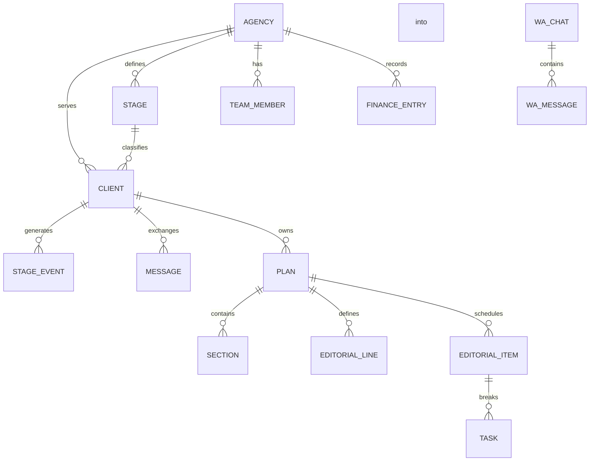

# Regma

🇺🇸 English · [🇧🇷 Português](README.pt-BR.md)

**An operations platform for marketing agencies and the people who manage clients and content.**

It brings CRM, editorial planning, client content approval, WhatsApp, automations and email
marketing into one place, with the agency's own client approving content from their phone,
without having to learn a new tool.

> **About this repository:** Regma is a commercial product and the **source code is private**.
> This space documents the problem, the architecture and the technical decisions behind it.
> Code access can be granted case by case during a hiring process, just ask.

`Next.js 16` · `TypeScript` · `PostgreSQL` · `Prisma` · `Supabase` · `Vercel` · `Claude API` · `Evolution API`

**Rolling out with its first real operation.**

---

## Who is who

The word "client" carries two meanings inside the product, so it is worth separating them:

| | Who they are | What they do in Regma |
|---|---|---|
| **Agency** | Regma's customer, the one who subscribes | Runs everything: CRM, planning, production, finance |
| **The agency's client** | The company that hires the agency | Enters the portal only: views, approves and comments on content from their phone |

That distinction is not vocabulary, it is the most important architectural decision in the
system. See [three identity layers](#three-identity-layers-on-purpose).

---

## The problem

A marketing agency operates scattered. Planning lives in one place, the calendar in another,
client approval turns into a WhatsApp thread with no record, and sales lives in a spreadsheet.
Nobody knows which piece of content is approved without going looking for it.

I lived this while running content for clients. I even used Notion to keep track, but most
clients could not use it, above all at the step that matters most, approval. A client does not
want to learn a tool: they want to open their phone, see the post and say yes or no.

Regma came out of that specific pain: **centralize the agency's operation without pushing
complexity onto the client.**

---

## What is built

| Area | What it does |
|---|---|
| **CRM** | Pipeline by stage, lead temperature, activity history, contact import |
| **Editorial** | Editorial lines, content plans, calendar, tasks and a production feed |
| **Client portal** | A space of its own to view, approve and comment on content from a phone |
| **WhatsApp** | Conversation inbox, media, send queue, converting a conversation into a lead |
| **AI** | Content idea generation, per-section suggestions, meeting summaries, briefings from a transcript |
| **Campaigns** | Email with a sender domain, suppression, delivery webhooks |
| **Automation** | Rules, flows, contact enrollment and scheduled processing |

Solo development. **285 commits · ~41k lines · 59 data models.**

---

## Architecture

```
┌──────────────────────────────────────────────────────────┐
│  Next.js 16 (App Router) · TypeScript · Vercel           │
│                                                          │
│  /(app)    agency dashboard       → NextAuth session     │
│  /cliente  client portal          → its own session      │
│  /u /f /briefing  public links    → token access         │
│  /api      ~70 routes                                    │
└───────┬──────────────────┬──────────────────┬────────────┘
        │                  │                  │
   ┌────▼─────┐      ┌─────▼──────┐   ┌───────▼──────────┐
   │ Postgres │      │  Supabase  │   │ Evolution server │
   │ (Prisma) │      │  Storage   │   │ self-hosted      │
   │59 models │      │  files     │   │ 1 instance/acct  │
   └──────────┘      └────────────┘   └───────┬──────────┘
                                              │ webhook
   ┌──────────────────┐  ┌───────────────┐    ▼
   │ Claude (Sonnet)  │  │  Google APIs  │  WhatsApp
   └──────────────────┘  └───────────────┘

                Vercel Cron (daily) → queue processing
```

The reasoning behind this shape lives in
**[docs/technical-decisions.md](docs/technical-decisions.md)**.

---

## Data model

The core entities and how they relate. The full schema has **59 models**; below are the twelve
that carry the main flow.



**The spine of the system is `Agency → Client → Plan → Editorial Item`.** The whole operation
hangs off that path: the CRM enters through `Stage`, production through `Task`, approval happens
on the `Editorial Item`, and WhatsApp connects a conversation to a client.

Per-agency scope is enforced in the schema: every top-level entity carries the link to the
agency that owns it, and no query crosses that boundary.

---

## Two decisions that define the system

### Three identity layers, on purpose

The agency authenticates through NextAuth. The agency's client gets a session of its own with a
password, because that person **should not exist as a platform user**: they do not see the
dashboard, do not take up a seat, do not get management permissions. And token links serve
whoever needs to see or answer one single thing, without creating an account.

Folding all of it into one auth system would have been simpler to build and worse to use. The
boundary between "who operates" and "who approves" is a product boundary, not an implementation
detail, so it is explicit in the architecture instead of becoming a role check scattered across
every screen.

### The WhatsApp server is self-hosted, and the reason is margin

The first version was a custom engine on Baileys, running locally. It worked, and it went down
every time the machine shut off. A persistent WhatsApp session needs a host that does not sleep,
and that is not solvable with effort: it is an infrastructure requirement.

The move was not to a paid provider, and the reason is commercial, not technical:

> A provider like Z-API charges **per number** (~R$100/month each). On a platform whose job is
> to supply the WhatsApp connection for all of its customers, per-unit pricing destroys the
> margin as soon as the base grows. A server of your own holds dozens of numbers at a fixed
> cost.

Today it is a **self-hosted Evolution server**, one instance per account, with the webhook
pointing back at the application.

**Trade-off:** infrastructure of my own to monitor, in exchange for a cost that does not grow
with the customer base. Unit cost determined the architecture, not the other way around.

---

## How the protections came about

None of the protections below came from a checklist. They came from a habit: after every
delivered area, I put my own code through an **adversarial review run with AI**, where the
question was not "does it work?" but *"how would someone break this?"*.

The AI raised the candidates. **The triage was mine:** what was a real finding and what was a
false positive, what was serious and what could wait, and in what order to fix. The repository
history shows the pattern: sweeps followed by commits that close the findings by severity,
worst first.

It was during one of those rounds that the **cross-account security flaw** appeared, the one
that produced the instance-naming golden rule described below. It would never have shown up in
usage testing: the product worked perfectly for anyone who was not trying to break into the
neighbor's account.

Worth saying plainly what that means: **the protections are not here because I knew I needed
them.** They are here because I went looking for what was wrong after I thought I was done, and
found it.

---

## Security

Decisions taken during construction:

- **Secrets never versioned**, `.env*` ignored from the start; across 285 commits, no
  environment file or key ever entered the repository
- **Service key stays on the server**, never exposed to the client
- **Personal data out of the code**, the access list lives in an environment variable and fails
  closed when it is not defined
- **Passwords with bcrypt**, never in plain text
- **Login attempt limiting** per identifier and IP
- **Account enumeration protection** in the client portal

The last one deserves the code, because it is the kind of thing that only shows up when you
think about attack surface (comments translated, identifiers kept as they are in the source):

```ts
/** Throwaway hash: when the email does not exist, we still spend the time of a
 *  bcrypt. Without this, "responds fast" becomes a way to find out which emails
 *  have an account. */
const HASH_FALSO = "$2a$12$..."
```

```ts
// Identical response for a nonexistent email, a disabled account and a wrong password:
// telling the cases apart would hand over who is a client.
const errada = NextResponse.json({ error: "E-mail ou senha incorretos." }, { status: 401 })
```

A login that answers fast for a nonexistent email and slowly for an existing one hands over the
list of who has an account. In a B2B product, that means handing over the agency's client book.

And in multi-tenant, the most dangerous surface is the neighbor:

```ts
/**
 * GOLDEN RULE: the instance name is ALWAYS derived from the session's dataId,
 * never read from the database. The name is predictable (`regma_<dataId>`), so
 * trusting a writable field would let one tenant point at another tenant's
 * connection, and send messages from someone else's number or request their QR.
 */
```

A resource identifier derived from the session, never from a field the user writes. Without
that, one agency could hijack another agency's WhatsApp connection.

### Open before use with third-party data
- [ ] Full review of tenant isolation
- [ ] Audit of storage access policies
- [ ] Review of token link expiry and scope

Per-user scope is enforced in the schema, but it has not been audited end to end, and until that
happens it does not go into use with real client data.

---

## Status

In active development. The core is built and navigable; what is left is polish, the security
review above, and launch.

---

**Gabriella Grecco** · [LinkedIn](https://linkedin.com/in/gabriellagrecco)
Source code private, access on request.
